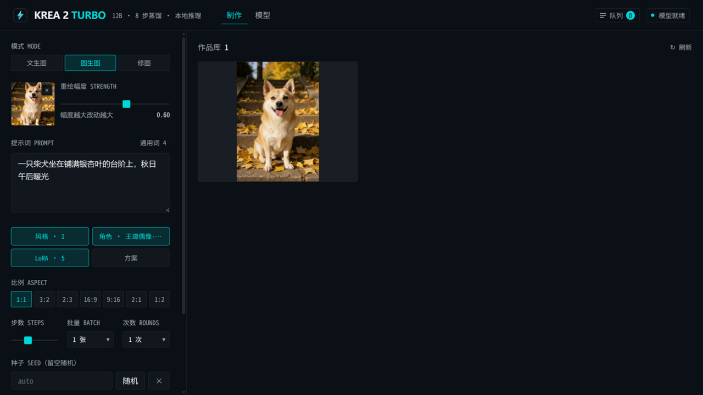
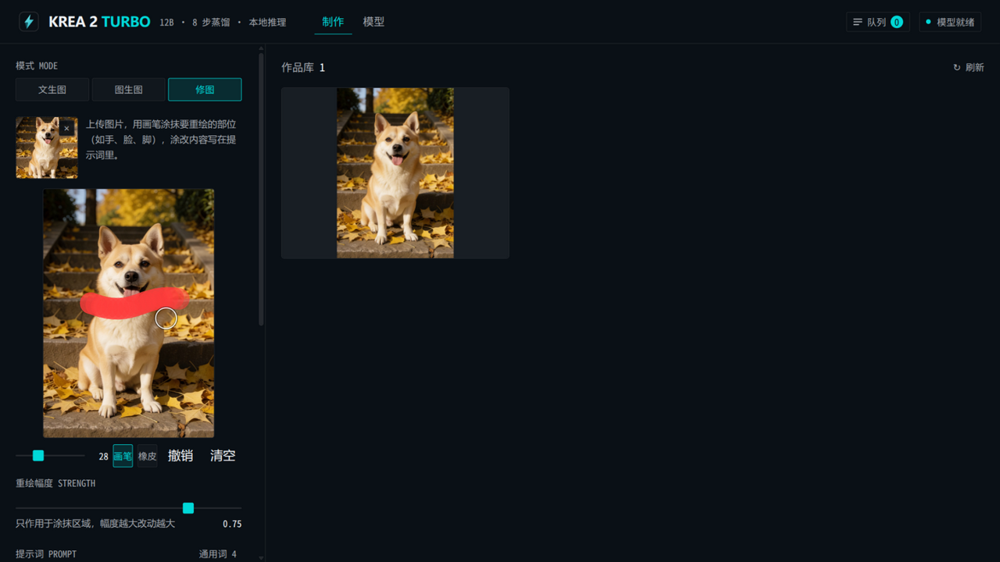

# Krea 2 Turbo 本地文生图工作台

基于 [Krea 2 Turbo](https://huggingface.co/krea/Krea-2-Turbo)（12B DiT 蒸馏文生图模型）的本地出图工作台：FastAPI 后端 + 原生 JS 前端 + Tailwind CSS v4。

**文生图**：风格/角色/LoRA/比例/批量全在左侧面板


**图生图（SDEdit）**：上传参考图，重绘幅度控制改动大小



**修图（局部重绘）**：画笔涂抹要改的部位（等大圆环光标），涂抹区按提示词重生成、其余逐像素保持



## 特性

- **8 步蒸馏出图**：`guidance_scale=0.0`，RTX 5090 上 1024² 约几秒一张
- **界面多语言（i18n）**：右上角下拉切换 中文 / English，选择记忆在 localStorage；中文为源语言，语言包是纯 JSON（`static/lang/{code}.json`，键为中文原句）——**想加新语言：复制 `static/lang/en.json` 逐条翻译值，再在 `static/lang/index.json` 登记一行即可**，切换器自动出现该语言，无需改任何代码
- **风格/角色预设**（历史 ComfyUI 预设迁移，`scripts/port_presets.py` 生成 `server/style_data.py`）
  - 风格 800+ 条中文名（弹窗选择：搜索中英文、分类分组、**按使用频率置顶**），可多选最多 4 个，按选择顺序嵌套 `{prompt}` 模板
  - 角色 56 条单选（多为专有人名保留原名），描述前置
  - 使用频率记入 `.usage.json`（按任务计，成功才计）；风格 negative_prompt 数据保留但 CFG=0 下不生效
- **图生图重绘（SDEdit）**：「模式 → 图生图」上传参考图 + 重绘幅度 0.05–0.95——参考图按比例中心裁剪后 VAE 编码，按幅度截断 sigma 表加噪去噪（与 QwenImage 官方管线同一套 `latents_mean/std` 编码约定）；构图保留、提示词改风格/细节，批量/次数/LoRA/种子全部通用
- **修图（局部重绘）**：「模式 → 修图」上传图片后用画笔涂抹要重绘的部位（手/脸/脚……，画笔大小可调，支持橡皮/撤销/清空，触屏可用）——涂抹区按提示词重生成，蒙版外**逐像素保持原图**（每步潜变量重注入 + 解码后像素级合成，与 QwenImageInpaintPipeline 同法）；原图 PNG 无损上传，输出尺寸跟原图；蒙版用轻微羽化，边缘自然过渡
- **LoRA 混合**：模型加载完成后 `loras/` 目录的 LoRA **默认全部加载并常驻显存**（不随生成自动卸载），默认强度 0.4；「模型」页开关可单独卸载/重载，强度 0–2 独立调节、拖动即时生效
  - 自动兼容两种格式：diffusers PEFT 格式直载；ComfyUI/kohya 格式（`diffusion_model.` 前缀）自动把 `alpha` 标量按 `alpha/rank` 预乘进 `lora_B` 后加载
- **模型/LoRA 目录配置**：写进 `.env`（首次使用从 `.env.example` 复制，**`KREA_MODEL_DIR` 必填**，代码不含任何个人路径默认值，未配置启动即报错指引）；`KREA_LORA_DIR` 可选（缺省 `<KREA_MODEL_DIR>/loras`），LoRA 名称即目录内文件名；改完重启生效
- **模型精度可选**（「模型」页，RTX 5090 32GB 实测，量化作用于 transformer；fp8 的文本编码器复用 int8）：
  | 精度 | 显存（常驻/峰值） | 8 步 1216×832 | 说明 |
  |---|---|---|---|
  | bf16 | offload 模式（峰值 ~24 GiB） | ~9s | 画质无损 |
  | fp8（torchao fp8 W8A8 + torch.compile） | ~16.7 / 20.7 GiB | **~3.8s** | 速度最快；首次生成前需预编译约 1 分钟 |
  | int8（torchao int8wo） | ~16.7 / 18.2 GiB | ~6.4s | 全 GPU，无需编译，即点即出 |
  | int4（bnb nf4） | ~9.9 / 11.4 GiB | — | 最省显存，画质略降 |
  精度切换需重载模型（约半分钟）。|

  **fp8 说明**：只量化 transformer（12.82B，占单步 97% 的时间），权重与激活都是 fp8 e4m3、per-row 动态量化，VAE 保持 bf16。`torch.compile` 融合激活量化/amax/rope/norm 等逐元素算子，实测每步 **766ms(int8) → 448ms(fp8)**；编译用 `dynamic=True`，一次覆盖所有分辨率。首次前向要编译约 1 分钟，`load_model` 完成后会在后台线程预先跑掉（模型页显示「预编译内核中」），此时提交的任务排队等编译结束。给 LoRA 激活状态切换（无 LoRA ↔ 有 LoRA）也要各编译一次。`KREA_FP8_COMPILE=0` 可关闭编译（退回 eager，约 670ms/步）。int8 不能挂编译：torchao int8 自定义算子实测 30 分钟不收敛。

  **预量化加速**：`python scripts/export_quantized.py all` 一次性把权重导出为 `models/Krea-2-Turbo-{int8,int4,fp8}/`（transformer 25G→12.0G/6.7G/12.8G、encoder 8.3G→4.5G/2.9G；fp8 只导 transformer），启动直读量化权重、免现场量化；同机清页缓存实测冷启动 **32s vs 现场量化 104s（约 3 倍）**。解析顺序：`.env` 显式指定（`KREA_MODEL_INT8_DIR`/`KREA_MODEL_INT4_DIR`/`KREA_MODEL_FP8_DIR`）→ 同级 `-int8/-int4/-fp8` 约定 → 现场量化；目录缺失时自动回退现场量化，删除不影响使用。
- **风格预设**：写实摄影 / 电影感 / 动漫 / 水墨 / 像素 / 低多边形 / 黑白 / 印象派 / 扁平海报
- **比例预设**：1:1、3:2、2:3、16:9、9:16、2:1、1:2（均为 16 像素倍数对齐）
- **步数 4–16、批量 1–4（每轮张数）、次数 1–8（跑几轮）、seed 固定复现**
  - 次数模式每轮独立跑一遍管线（每轮 `batch` 张、种子 = 基种子 + 轮号），图片逐轮落盘并实时进画廊；中途失败保留已完成轮次的图
- **面板参数本地记忆**：提示词、风格、比例、步数、批量、次数、种子、精度、LoRA 强度自动存入浏览器 localStorage，刷新/重开自动恢复上次的调整（存档失效自动回默认）
- **作品库**：落盘 `outputs/`（jpg + 同名 json 元数据，含 LoRA 参数），画廊 / 灯箱 / 下载 / 删除
- **模型 CPU offload**：12B DiT + Qwen3-VL 文本编码器按需进出 32GB 显存
- **双视图界面**：顶栏「制作 / 模型」切换 —— 制作页专注出图（LoRA 只留摘要条），模型页管理基础模型状态与 LoRA 开关/强度

> 注意：蒸馏模型 CFG 已关闭，**负面提示词无效**，所以界面没有这个输入。

## 启动与管理

```bash
./install.sh               # 一键安装（虚拟环境+依赖+交互式生成 .env）
# 或手动：cp .env.example .env（编辑 KREA_MODEL_DIR）→ 见下方手动步骤
chmod +x server.sh

./server.sh start          # 后台启动（默认 int8，也可指定 bf16|fp8|int8|int4；端口默认 8420）
./server.sh status         # 进程 / 模型 / LoRA / 显存状态
./server.sh log -f         # 跟随日志（或 log 30 看最近 30 行）
./server.sh restart        # 重启（沿用上次精度；也可带精度参数）
./server.sh stop           # 停止

./server.sh run bf16       # 前台运行（默认 int8，Ctrl+C 停止），./server.sh fp8 是它的等价写法
```

或手动分步：

```bash
# 1) Python 环境（torch 需 cu128 及以上以支持 5090/Blackwell）
uv venv --python 3.12 .venv
uv pip install --python .venv/bin/python -r requirements.txt

# 2) 前端 CSS（开发时用 bun run css:watch）
bun install
bun run css:build

# 3) 起服务（首次加载模型约 58GB，需几分钟；精度用环境变量 KREA_PRECISION 指定）
.venv/bin/python -m uvicorn server.main:app --host 127.0.0.1 --port 8420
```

浏览器打开 <http://127.0.0.1:8420>。顶栏徽标显示「模型就绪」即可出图。

## 配置

模型/LoRA 目录写进 `.env`（`KREA_MODEL_DIR` / `KREA_LORA_DIR`，参考 `.env.example`；预量化目录 `KREA_MODEL_INT8_DIR`/`KREA_MODEL_INT4_DIR`/`KREA_MODEL_FP8_DIR` 可选），改后 `./server.sh restart` 生效。

**API 访问密钥（必填）**：`.env` 的 `KREA_API_KEY`——所有 `/api/*` 接口要求 `X-API-Key` 头，浏览器 UI 首次打开时弹窗输入一次（存 localStorage）。生成：`openssl rand -hex 16`；`./server.sh start` 缺失时会自动生成并写回 `.env`，`./server.sh key` 随时查看。脚本/curl 调用示例：

```bash
curl -H "X-API-Key: $(./server.sh key)" http://127.0.0.1:8420/api/status
```

**命令行出图**：`scripts/gen.py`（纯标准库）走同一套 API 与队列，密钥自动从 `.env` 读取：

```bash
scripts/gen.py "一只柴犬坐在铺满银杏叶的台阶上" --style photo --aspect 2:3
scripts/gen.py "换条红围巾" --image 输入图.jpg --strength 0.75   # 图生图
scripts/gen.py "霓虹小巷" --style cinema --rounds 4 --out-dir ./out  # 批量并收集成图
```

**MCP server（给 AI agent 用）**：`scripts/mcp_server.py`——stdio 传输，与 HTTP API 同一个 `KREA_API_KEY`（自动读 `.env`，客户端零密钥配置）。注册到 ZCode / Claude Desktop 等 MCP 客户端：

```json
{
  "mcpServers": {
    "krea2-turbo": {
      "command": "<项目路径>/.venv/bin/python",
      "args": ["<项目路径>/scripts/mcp_server.py"]
    }
  }
}
```

四个工具：`generate`（文生图/图生图/局部重绘，自动等待完成并返回图片路径与完整提示词）、`list_styles`（风格 id 与中文名）、`list_images`（最近作品）、`get_status`（模型/显存/LoRA 状态）。风格参数既可用 id 也可用中文名。

每张图的 meta（`outputs/*.json`）同时记录用户提示词与**拼装后的完整提示词**（通用词 + 角色 + 风格模板 + 提示词），跨工具复现不用猜。

## 结构

```
server/
  main.py        FastAPI 路由（status / presets / generate / tasks / images）
  pipeline.py    模型后台加载 + 单线程生成队列 + 步级进度
  presets.py     风格与比例预设
static/
  index.html     工作台界面（暗色，design-forge Signal 配方）
  app.js         状态轮询 / 画廊 / 灯箱
  css/src/       Tailwind v4 源 + forge-tokens.css（脚本生成）
  css/dist/      构建产物（不手改）
outputs/         生成图片 + json 元数据
```
